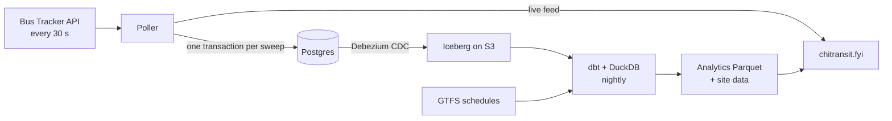

# chitransit

How Chicago's buses are really running: live long waits and bunching, and a daily record of every scheduled trip that ran, was flagged as canceled, or never showed up.

**[chitransit.fyi](https://chitransit.fyi)** · *Not affiliated with the Chicago Transit Authority. Data provided by CTA.*

## How it works



- **Poller** (Python) stores every API response and the rows parsed from it in Postgres, and writes the live feed the site reads.
- **Debezium** streams Postgres's change log to Iceberg tables on S3: the full, locked history.
- **dbt + DuckDB** rebuilds the last few days each night: stop passes, trip outcomes against that day's schedule, headways and gaps.
- **Site**: Astro, Svelte and MapLibre, static on S3 + CloudFront.

Infra is Terraform on AWS (one Lightsail box, S3, Glue, CloudFront) with GitHub Actions for CI, deploys and the nightly. Runbook: [infra/README.md](infra/README.md).

## Local development

Needs Docker, [uv](https://github.com/astral-sh/uv) and a [Bus Tracker API key](https://www.ctabustracker.com/) in `CTA_BUS_TRACKER_API_KEY`.

```bash
git clone git@github.com:sohammandal/chitransit.git && cd chitransit
make install     # dependencies and git hooks
make up          # Postgres on :5433, migrations
make poll        # run the poller (dev polls a few routes)
make test        # tests; make lint for pre-commit
make transform   # dbt, reading prod Ingress read-only
cd site && npm install && npx astro dev
```

Settings: `.env.example`. Schema changes go in a new migration under `db/migrations/`.

## Prior art

[Ghost Buses](https://github.com/chihacknight/chn-ghost-buses), [CTA StopWatch](https://github.com/mansueto-institute/cta-stop-watch), [chicago-transit-insights](https://github.com/cailinpitt/chicago-transit-insights), [Ghost Bus Index](https://github.com/dulcetberg/us-ghost-buses), [CTA Reliability Tracker](https://github.com/brandonmcfadd/cta-reliability), [MBTA LAMP](https://github.com/mbta/lamp), [TIDES](https://tides-transit.github.io/TIDES/main/tables/).

## License

[MIT](LICENSE)
