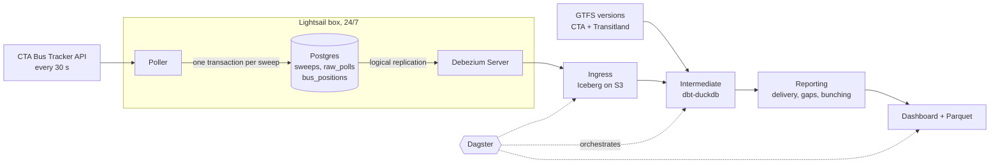

# CTA Ghost Ledger

[](https://www.python.org/)
[](https://github.com/astral-sh/uv)
[](https://www.postgresql.org/)
[](https://debezium.io/)
[](https://iceberg.apache.org/)
[](https://duckdb.org/)
[](https://www.getdbt.com/)
[](https://dagster.io/)
[](https://github.com/astral-sh/ruff)

> A replayable record of scheduled CTA service - which bus trips **ran**, which CTA **flagged as canceled**, and which **silently never showed up** - judged against the schedule that was in force each day.

A learning project built around *Designing Data-Intensive Applications* (2nd ed.): change data capture, event time vs processing time, slowly changing dimensions, idempotent reprocessing and a lakehouse on object storage, applied to a real Chicago problem. 'L' trains follow once the Train Tracker key arrives.

*Not affiliated with the Chicago Transit Authority. Data provided by CTA.*

---

## Problem

CTA reports that buses delivered 98.8% of scheduled trips in June 2025, and since May 2025 it flags canceled trips in rider apps. But a high delivery rate can still mean two buses together and then a 25-minute gap, and a cancellation flag only helps if every missing trip actually gets one.

This project answers questions the public data can't:

- What share of missing trips does CTA **flag** as canceled, and how many vanish **silently**?
- Which routes deliver their trips but **bunch** them, leaving long gaps at rush hour?
- How does service compare across routes, neighborhoods and hours, measured against **that day's** schedule?

Others have built parts of this (see [Prior art](#prior-art)). The new piece is auditing CTA's cancellation flags against observed service, trip by trip.

---

## Architecture

The poller writes to exactly one place. Everything downstream is derived from Postgres's change log (DDIA ch. 12-13: one system of record, no dual writes).



| Layer | What lives there |
|-------|------------------|
| **Postgres (`ops`)** | The system of record: every sweep, API call and bus sighting is written here first, and Postgres decides their order. Keeps about two days. |
| **Ingress** | The complete CDC log in Iceberg, append-only and replayable by log position. After two days it is the only copy, so it is protected and never rebuilt. |
| **Intermediate** | Schedule and route-pattern versions (SCD2), scheduled trips, interpolated stop passes, flagged cancellations |
| **Reporting** | `route_hour_delivery`, `stop_hour_gaps`, `bunching_events`, with coverage on every row |

Each scheduled trip lands in one of three buckets: **ran**, **flagged canceled** (CTA's `dyn=1`), or **silent ghost** (never flagged, never seen), counted only when the feed was healthy.

---

## Tech Stack

| Layer | Tool | Status |
|-------|------|--------|
| Ingestion | Python poller, `httpx` | In progress (week 1) |
| System of record | PostgreSQL 17, logical replication | Ready |
| Change data capture | Debezium Server | Week 2 |
| Hosting | AWS Lightsail 2 GB (poller, Postgres, Debezium) | Week 2 |
| Lakehouse | Apache Iceberg on Amazon S3 | Week 2 |
| Transformation | dbt + DuckDB | Week 3 |
| Orchestration | Dagster | Weeks 2-4 |
| Dev Tools | `uv`, `ruff`, `sqlfluff`, `pre-commit`, `pytest` | Ready |

Target cost: about $14/month (a $12 Lightsail box plus S3). Managed Postgres free tiers and Estuary were ruled out for 24/7 running at bus volume (~2.6M sightings/day).

---

## Data Sources

| Source | Used for |
|--------|----------|
| [CTA Bus Tracker API v3](https://www.transitchicago.com/developers/bustracker/) | Live positions (`getvehicles`), route patterns (`getpatterns`), cancellation flags (`getpredictions`) |
| [CTA static GTFS](https://www.transitchicago.com/developers/gtfs/) | The current schedule |
| [Transitland archive](https://www.transit.land/feeds/f-dp3-cta) | ~100 historical schedule versions since 2021 |
| [Ghost Buses / CTA StopWatch](https://github.com/mansueto-institute/cta-stop-watch) | 5-minute bus history (2022 to today) for backfill and cross-checks |

---

## Roadmap

- [x] **Scaffold** - uv project, Postgres with logical replication, Bus Tracker client, tooling
- [ ] **Week 1 - Ingest** - poll every route every 30 s into Postgres; prove trip matching on route 79 (1-hour spike: 76/76 trips on #79 and #9 matched exactly one GTFS trip)
- [ ] **Week 2 - CDC to lakehouse** - Debezium → Iceberg on S3; move to the Lightsail box; outage-recovery drill; compaction; prune gate
- [ ] **Week 3 - Schedules and stop passes** - SCD2 schedule and pattern versions, stop-pass interpolation, cancellation sampler
- [ ] **Week 4 - Metrics and dashboard** - reporting tables, freshness and integrity checks, replay drill
- [ ] **Later - 'L' trains** - second poller once the Train Tracker key arrives

---

## Project Structure

```
cta-ghost-ledger/
├── src/ghost_ledger/           # The one Python package
│   ├── bustracker.py           # Bus Tracker v3 client: retries, DST-safe timestamps
│   ├── config.py               # dev/prod settings (GHOST_LEDGER_ENV), quota guard
│   ├── ingest/                 # Poller: sweeps into Postgres, one transaction each
│   ├── monitor.py              # Timeliness metrics for CloudWatch alarms
│   └── cli.py                  # ghost-ledger env | routes | vehicles | poll | monitor | check-db
├── db/migrations/              # Postgres schema as dbmate migrations (make migrate)
├── infra/                      # Prod: Terraform (bootstrap, prod), box setup + deploy scripts; runbook in infra/README.md
├── .github/workflows/          # CI: lint + tests with Postgres; image to GHCR on main
├── scripts/                    # Spikes and run checks (check_run.py), not imported by the package
├── tests/                      # pytest
├── data/                       # Local data (gitignored)
├── compose.yml                 # Postgres 17 (wal_level=logical, port 5433) + dbmate
├── compose.prod.yml            # Prod layer: tuned Postgres on 127.0.0.1, migrate, poller, monitor
├── Dockerfile                  # The prod image (code, migrations, dbmate, deploy files)
├── Makefile                    # Common commands
├── pyproject.toml              # Project, ruff and pytest config
├── .sqlfluff                   # SQL lint rules
├── .pre-commit-config.yaml     # Hygiene, ruff and sqlfluff hooks
├── .env.dev                    # Committed dev defaults (no secrets)
└── .env.example                # Every setting, documented
```

Folders follow the pipeline, and each one appears when its week starts: `cdc/` (Debezium config), `transform/` (dbt), `infra/terraform/` and `dashboard/` are still to come.

---

## Local Development

1. **Clone the repo:**

   ```bash
   git clone git@github.com:sohammandal/cta-ghost-ledger.git
   cd cta-ghost-ledger
   ```

2. **Get a Bus Tracker API key** from your [Bus Tracker account](https://www.ctabustracker.com/) (My Account → Developer API) and export it, for example in `~/.secrets`:

   ```bash
   export CTA_BUS_TRACKER_API_KEY="..."
   ```

   > In dev, environment variables win over `.env`, which wins over the committed `.env.dev`. See `.env.example` for every setting. Never commit keys.

3. **Install [uv](https://github.com/astral-sh/uv):**

   ```bash
   curl -LsSf https://astral.sh/uv/install.sh | sh
   ```

4. **Install dependencies and git hooks:**

   ```bash
   make install        # uv sync + pre-commit install
   ```

5. **Start Postgres** (Docker required):

   ```bash
   make up             # Postgres 17 on localhost:5433, then apply migrations
   make check-db       # wal_level, ops tables, CDC publication, partitions
   ```

6. **Smoke-test the API:**

   ```bash
   make routes         # lists bus routes
   make vehicles       # live buses on route 79 (or: make vehicles RT="9 79")
   ```

7. **Lint and test:**

   ```bash
   make lint           # pre-commit on all files (ruff, sqlfluff, hygiene)
   make test
   ```

Other commands: `make psql` (shell into Postgres), `make migrate-status`, `make new-migration NAME=...`, `make db-reset` (drop the local database and rebuild it from migrations), `make down`.

Schema changes always go in a new migration under `db/migrations/`; never edit an applied one.

### Dev and prod

The same code runs in two environments, chosen by `GHOST_LEDGER_ENV` (default `dev`):

| | dev | prod |
|---|---|---|
| Where | your laptop, Docker | the Lightsail box (week 2) |
| Settings | environment > `.env` > `.env.dev` | environment only (the box's env file); prod never reads repo files |
| Make | `make migrate` | `make migrate ENV=prod CONFIRM=prod` (refuses without `CONFIRM`; `db-reset` always refuses) |
| Compose | `compose.yml` | `compose.yml` + `compose.prod.yml` |

`make env` prints the resolved settings with secrets redacted, including the daily API-call estimate. `make poll` runs the poller and `make monitor` prints the monitor's metrics once.

**Rehearsing prod locally:** `make rehearse` builds the image and runs the real deploy path (`infra/box/deploy.sh` + `compose.prod.yml`) as project `ghost-ledger-rehearsal`, with a throwaway env file in `data/rehearsal/`, two routes and metrics to the log. `make rehearse-logs`, `make rehearse-psql`, `make rehearse-down`.

**Deploying:** prod is pull-based. CI pushes `ghcr.io/sohammandal/ghost-ledger:main` after tests pass on `main`; a timer on the box runs `deploy.sh` every 5 minutes, which redeploys only when the image changed. Dev and prod share one API key (100k calls/day): once prod polls 24/7, set `POLL_ROUTES=79,9` for dev.

### What Happens If Hooks Fail?

* If a hook auto-fixes files (e.g. formatting with `ruff` or `sqlfluff`), the commit will be blocked.
* Simply **`git add .` and commit again** - your files will now be fixed and pass.
* If errors remain (like lint violations), you must resolve them manually before committing.

### Adding a New Package/Dependency

```bash
uv add <package-name>               # runtime dependency
uv add --group dev <package-name>   # dev tooling
```

Commit the updated `pyproject.toml` and `uv.lock`; others run `uv sync`.

---

## Prior art

This builds on, and borrows from, earlier Chicago transit work:

- [Chi Hack Night Ghost Buses](https://github.com/chihacknight/chn-ghost-buses) and [Mansueto CTA StopWatch](https://github.com/mansueto-institute/cta-stop-watch) - scheduled vs observed buses, stop-pass interpolation, historical GTFS
- [chicago-transit-insights](https://github.com/cailinpitt/chicago-transit-insights) - live bunching, gap and ghost detection
- [Ghost Bus Index](https://github.com/dulcetberg/us-ghost-buses) - multi-city ghost rates and feed validity tests
- [CTA Reliability Tracker](https://github.com/brandonmcfadd/cta-reliability) - scheduled vs actual 'L' trains, 2022-2026
- [MBTA LAMP](https://github.com/mbta/lamp) and [TIDES](https://tides-transit.github.io/TIDES/main/tables/) - event models and table standards

---

## License

[MIT](LICENSE)
