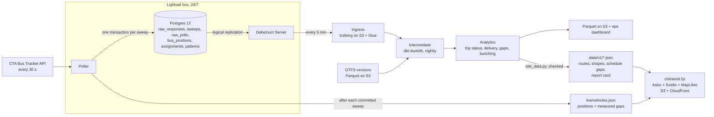

# chitransit

[](https://www.python.org/)
[](https://aws.amazon.com/)
[](https://www.postgresql.org/)
[](https://debezium.io/)
[](https://iceberg.apache.org/)
[](https://duckdb.org/)
[](https://www.getdbt.com/)
[](https://www.terraform.io/)

> A replayable record of scheduled CTA service - which bus trips **ran**, which CTA **flagged as canceled**, and which **silently never showed up** - judged against the schedule that was in force each day.

Public site: **[chitransit.fyi](https://chitransit.fyi)** - how CTA buses are really running, right now and on the record.

*Not affiliated with the Chicago Transit Authority. Data provided by CTA.*

---

## Problem

Riders experience the bus system at a stop: how long they wait, and how evenly the buses come. CTA publishes its live bus positions, schedules and service alerts as open data, which makes it possible to see how service is going across the whole system, as it happens and day by day. `chitransit` is an independent view built on that data, alongside CTA's own tools.

`chitransit` shows how Chicago's buses are really running, from CTA's own GPS:

- **Right now:** every bus on one map; where riders are in a **long wait** (far longer than the schedule's gap since a bus last passed a stop) and where buses run **together**.
- **Per route and stop:** each direction as a line with its gaps, the bus ahead and behind, and how long since a bus last passed a stop. Distances along the route, never forecasts.
- **On the record:** every scheduled trip each day, marked **ran**, **flagged as canceled** by CTA, or **never showed up**, judged against the schedule in force that day.

Claims come only from what the GPS shows. When the data can't settle a question (a bus that stopped reporting, a detour), the site says it can't tell rather than guess.

Others have built parts of this (see [Prior art](#prior-art)).

---

## Architecture

The poller writes its data to exactly one place. Everything downstream is derived from Postgres's change log (one system of record, no dual writes). The site never queries a database: it reads two kinds of static files, one live and one nightly.



| Layer | What lives there |
|-------|------------------|
| **Postgres (`ops`)** | The system of record. Every API response is stored byte for byte (`raw_responses`), next to the parsed rows built from it, in one transaction per 30 s sweep; Postgres decides their order (the LSN). Keeps about two days. |
| **Ingress** | The complete change log as Iceberg tables on S3 (Glue catalog): one row per change with its operation and log position. After two days it is the only copy, so it is protected and never rebuilt. |
| **Intermediate** | Schedule and route-pattern versions (SCD2), scheduled trips, interpolated stop passes, flagged cancellations |
| **Analytics** | `trip_status` (every scheduled trip: ran / flagged / silent / unknown), `route_hour_delivery`, `stop_hour_service` (headways, gaps, bunching), published as Parquet partitioned by service date |
| **Site: live** | `live/vehicles.json`, rewritten by the poller after each committed sweep (a disposable view of the same sweep, never a second write path): every bus, and the measured time since the last bus passed its spot |
| **Site: nightly** | `data/v1/*.json` from the Analytics tables and their published history: route names and shapes, scheduled gaps for today and tomorrow, and the report card. Checked against the site's contract before upload |

Each scheduled trip lands in one of three buckets: **ran**, **flagged canceled** (CTA's `dyn=1`), or **silent ghost** (never flagged, never seen), counted only when the feed was healthy. Trips on detour patterns are counted as unknown, never as ghosts.

---

## Tech Stack

| Component | What it does | Why |
|---|---|---|
| **CTA Bus Tracker API** (+ Customer Alerts, GTFS) | Live bus positions, CTA's own announcements (canceled, will not stop), schedules | The only official, live, system-wide source |
| **Python poller** (uv, Python 3.13) | Polls every bus every 30 s, samples predictions every 5 min, computes live waits in memory | Simple and reliable; the live math runs in milliseconds |
| **PostgreSQL 17** | System of record: each sweep in one transaction; keeps about 2 days | Fast, safe writes and one ordered log (one writer, no dual writes) |
| **Debezium (CDC)** | Streams Postgres's change log into the lake | An exact, ordered copy with no second write path to drift |
| **Apache Iceberg on S3** (AWS Glue catalog) | The permanent lakehouse (Ingress), data files locked for 10 years | Cheap storage, atomic commits, time travel, schema evolution; any engine can read it (DuckDB today, Spark or Snowflake tomorrow) |
| **dbt + DuckDB** | Nightly trip outcomes, stop passes and report cards from raw history | Fast on one machine, free compute, tested business rules with one definition per metric |
| **GitHub Actions + AWS EventBridge** | CI, deploys and the nightly schedule | Free and simple; EventBridge makes the nightly start on time |
| **Astro + Svelte** | The public website: a static page with interactive parts | No server to run or scale, instant loads, feels like a native app |
| **MapLibre + OpenFreeMap** | Live map and basemap | Open source and free; no API keys or per-view pricing |
| **S3 + CloudFront** (CDN) | Serves the site and the live feed file | Instant and a few dollars a month; 10 visitors or 10,000 read the same cached files, so there's no performance or cost hit as traffic grows |
| **AWS Lightsail** | One $12/month box running the poller, Postgres and Debezium | Right-sized: one box handles the load |
| **Terraform + GitHub OIDC** | Every AWS resource as code; no stored AWS keys in CI | Reproducible, reviewable and secure infrastructure |
| **CloudWatch alarms + SNS email** | Alerts when the poller, CDC, the lake or the nightly report goes stale | Gaps can't be backfilled, so problems must surface within minutes |

Total running cost: about $15–20 a month, and it stays flat as traffic grows: visitors only read precomputed files from the CDN, never the server or the database.

---

## Data Sources

| Source | Used for |
|--------|----------|
| [CTA Bus Tracker API v3](https://www.transitchicago.com/developers/bustracker/) | Live positions (`getvehicles`), route patterns (`getpatterns`), cancellation flags (`getpredictions`) |
| [CTA static GTFS](https://www.transitchicago.com/developers/gtfs/) | The current schedule |
| [CTA Customer Alerts API](https://www.transitchicago.com/developers/alerts/) | CTA's own announcements (reroutes, disruptions), as context for gaps |

---

## Project Structure

```
chitransit/
├── src/ghost_ledger/           # The one Python package
│   ├── bustracker.py           # Bus Tracker v3 client: retries, DST-safe timestamps
│   ├── config.py               # dev/prod settings (GHOST_LEDGER_ENV), quota guard
│   ├── ingest/                 # Poller: sweeps into Postgres, one transaction each
│   ├── live.py                 # The site's live feed: positions and measured gaps after each sweep
│   ├── monitor.py              # Timeliness metrics for CloudWatch alarms
│   └── cli.py                  # ghost-ledger env | routes | vehicles | poll | monitor | check-db
├── infra/                      # Terraform (bootstrap, prod), box setup + deploy.sh; runbook in infra/README.md
│   ├── db/migrations/          # Postgres schema as dbmate migrations (make migrate)
│   └── cdc/debezium/           # Debezium Server config (dev: local Iceberg; prod: S3 + Glue)
├── .github/workflows/          # CI: lint, tests with Postgres, image to GHCR; Terraform plan/apply
├── transform/                  # dbt project (staging, intermediate, analytics), GTFS loader, publish, dashboard, site data
├── site/                       # chitransit.fyi: Astro + Svelte (src/components, src/lib), Playwright tests (e2e/)
├── scripts/                    # Checks, audits and replays (check_ingress.py, replay_gaps.py); not imported
├── tests/                      # pytest
├── data/                       # Local data (gitignored)
├── compose.yml                 # Postgres 17 (wal_level=logical, port 5433), dbmate, Debezium (profile cdc)
├── compose.prod.yml            # Prod layer: tuned Postgres on 127.0.0.1, migrate, poller, monitor, Debezium
├── Dockerfile                  # The prod image (code, migrations, dbmate, deploy files)
├── Makefile                    # Common commands
├── pyproject.toml              # Project, ruff and pytest config
├── .sqlfluff                   # SQL lint rules
├── .pre-commit-config.yaml     # Hygiene, ruff and sqlfluff hooks
├── .env.dev                    # Committed dev defaults (no secrets)
└── .env.example                # Every setting, documented
```

Folders follow the pipeline and appear when their stage starts.

---

## Local Development

1. **Prerequisites:** Docker, [uv](https://github.com/astral-sh/uv) (`curl -LsSf https://astral.sh/uv/install.sh | sh`), and a Bus Tracker API key from your [Bus Tracker account](https://www.ctabustracker.com/) (My Account → Developer API), exported in your shell:

   ```bash
   export CTA_BUS_TRACKER_API_KEY="..."
   ```

   > In dev, environment variables win over `.env`, which wins over the committed `.env.dev`. See `.env.example` for every setting. Never commit keys.

2. **Clone, install and start Postgres:**

   ```bash
   git clone git@github.com:sohammandal/chitransit.git && cd chitransit
   make install        # uv sync + pre-commit hooks
   make up             # Postgres 17 on localhost:5433, then apply migrations
   ```

3. **Check everything works:**

   ```bash
   make check-db       # wal_level, ops tables, CDC publication, partitions
   make vehicles       # live buses on route 79 (or: make vehicles RT="9 79")
   make lint && make test
   ```

4. **Run the site** (Node 22.12+): `cd site && npm install && npx astro dev`. It reads prod's live feed and nightly files, so it works without a local poller.

Other commands: `make psql` (shell into Postgres), `make migrate-status`, `make new-migration NAME=...`, `make db-reset` (drop the local database and rebuild it from migrations), `make down`.

Schema changes always go in a new migration under `infra/db/migrations/`; never edit an applied one.

### Dev and prod

The same code runs in two environments, chosen by `GHOST_LEDGER_ENV` (default `dev`):

| | dev | prod |
|---|---|---|
| Where | your laptop, Docker | the Lightsail box |
| Settings | environment > `.env` > `.env.dev` | environment only (the box's env file); prod never reads repo files |
| Make | `make migrate` | `make migrate ENV=prod CONFIRM=prod` (refuses without `CONFIRM`; `db-reset` always refuses) |
| Compose | `compose.yml` | `compose.yml` + `compose.prod.yml` |

`make env` prints the resolved settings with secrets redacted, including the daily API-call estimate. `make poll` runs the poller and `make monitor` prints the monitor's metrics once.

**Rehearsing prod locally:** `make rehearse` builds the image and runs the real deploy path (`infra/box/deploy.sh` + `compose.prod.yml`) as project `ghost-ledger-rehearsal`, with a throwaway env file in `data/rehearsal/`, two routes and metrics to the log. `make rehearse-logs`, `make rehearse-psql`, `make rehearse-down`.

**Deploying:** prod is pull-based. CI pushes `ghcr.io/sohammandal/ghost-ledger:main` (and a commit-SHA tag) only after tests pass on `main`; a timer on the box runs `deploy.sh` every 5 minutes, which redeploys only when the image changed. After each deploy a sweep must commit within ~2 minutes, or the box rolls back to its last good image. Migration rules and the manual rollback are in [infra/README.md](infra/README.md#deploy-safety). Dev and prod share one API key (100k calls/day), so dev polls only `79,9` (`.env.dev`).

**CDC in dev:** `docker compose --profile cdc up -d debezium` streams the dev database into Iceberg tables under `data/lake/`.

### Transform (dbt)

The batch layer is derived only from Ingress and the GTFS versions, for a window of service dates (default: the last 3), so any run can be repeated or replayed.

- **Dev:** `make transform` (optionally `VARS='{start_date: 2026-09-26, end_date: 2026-09-26}'`) builds every model into `transform/target/ghost_ledger.duckdb`, reading prod Ingress **read-only** through Glue. Nothing is published. Inspect with `dbt show` or DuckDB.
- **CI:** every push and PR runs `dbt build --empty` with a read-only role: all models compile against the real sources, and the data tests and business-rule unit tests run.
- **Prod:** `.github/workflows/nightly.yml` at 11:23 UTC (06:23 CDT, started by EventBridge): load a new GTFS feed if CTA published one, check Ingress freshness, `dbt build`, publish the analytics tables to `s3://…/analytics/` (each service date's partition is replaced), rebuild the dashboard (`make dashboard` opens it).
- **Changing a rule:** edit the model and its unit test, run `make transform` on recent days and compare, push (CI), then rerun the nightly workflow by hand with a `start_date`/`end_date` range to rebuild history from Ingress.

---

## Prior art

This builds on, and borrows from, earlier Chicago transit work:

- [Chi Hack Night Ghost Buses](https://github.com/chihacknight/chn-ghost-buses) and [Mansueto CTA StopWatch](https://github.com/mansueto-institute/cta-stop-watch) - scheduled vs observed buses, stop-pass interpolation, historical GTFS
- [chicago-transit-insights](https://github.com/cailinpitt/chicago-transit-insights) - live bunching, gap and ghost detection
- [Ghost Bus Index](https://github.com/dulcetberg/us-ghost-buses) - multi-city ghost rates and feed validity tests
- [CTA Reliability Tracker](https://github.com/brandonmcfadd/cta-reliability) - scheduled vs actual 'L' trains, 2022-2026
- [MBTA LAMP](https://github.com/mbta/lamp) and [TIDES](https://tides-transit.github.io/TIDES/main/tables/) - event models and table standards

---

## License

[MIT](LICENSE)
